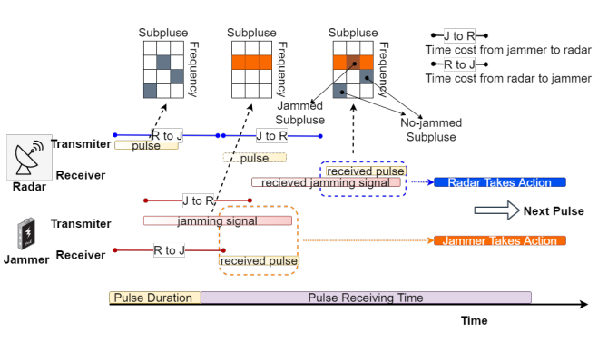
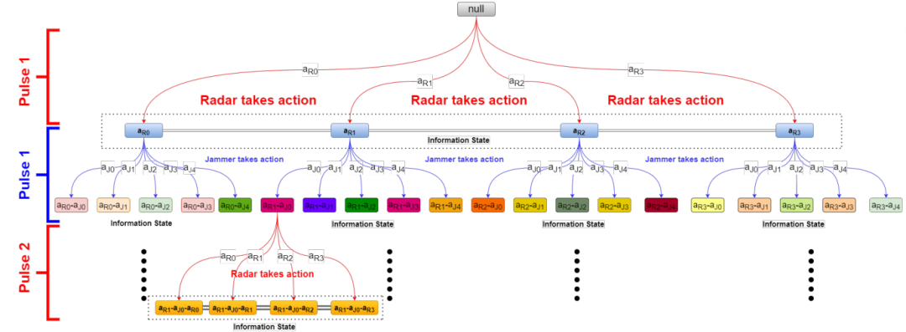
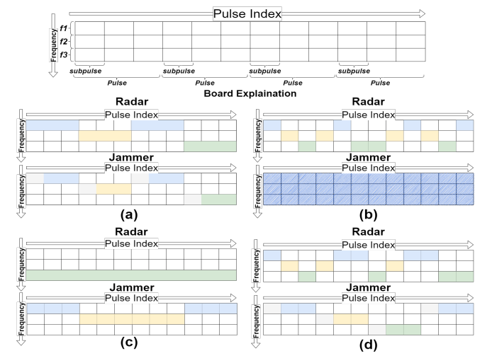
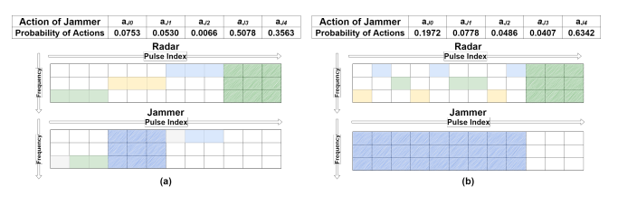
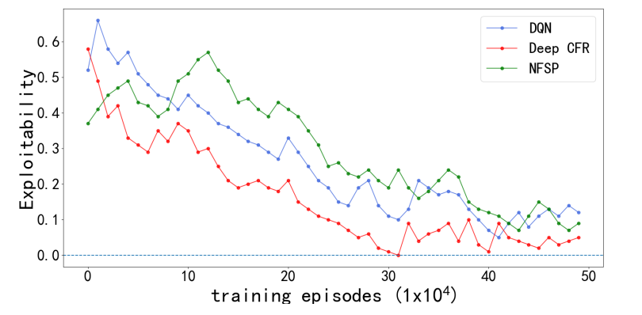

# [Anti-interference] Study on Frequency Hopping Radar Anti-interference Game Based on Minimizing Anticipated Regrets

Introduction: Electronic jamming is a significant topic in the field of radar signal processing. Many signal processing techniques have been proposed in the past, which can be considered passive methods. These techniques aim to eliminate interference signals after the radar is affected by them, but the anti-jamming performance that separates target signals from the interfered signals is usually limited. Conversely, active methods, by adopting appropriate strategies for pre-emitted signal parameters to avoid being interfered, are expected to achieve better performance. Frequency hopping radars, which change the carrier frequency of the transmitted signal, are typical radar systems for implementing active jamming methods, and their success hinges on the carrier frequency selection strategy.
Early research explored the anti-jamming problem from the perspective of game theory, focusing on game analysis. In recent years, some reinforcement learning-based strategy design methods have gained attention, where the jammer is modeled as an environment, and the radar acts as an intelligent agent, making sequential decisions through interaction with the jammer. Research has proposed deep reinforcement learning methods for the carrier frequency selection issue of frequency hopping radars; others have suggested using Q-learning to select carrier frequencies and pulse widths; and still others have modeled the anti-jamming problem of frequency hopping radars as a partially observable Markov decision process and proposed deep Q-network learning methods. However, modeling the jammer as a static environment (i.e., fixed jamming rules) may not be effective against jammers with time-varying rules. Recent studies have proposed robust anti-jamming strategy designs to address this issue, but the above single-agent reinforcement learning studies overlook the learning ability of the jammer, which could limit their practical applications.
On the contrary, modeling the confrontation between radar and jammer as a game allows for capturing both parties' learning capabilities. Since modern frequency hopping radars often employ multi-pulse coherent processing, the classic regular form game cannot describe the interactions between pulses and the possible information incompleteness during the confrontation.
This paper introduces the extended game to model the confrontation between radar and jammer. The extended game can be represented by a game tree, recording information about multiple pulse interactions. Due to the exponential growth of the scale of the extended game with the number of pulses, solving the Nash equilibrium strategy may be computationally challenging. To effectively solve this game, this paper adopts a deep counterfactual regret minimization algorithm based on learning. Simulation results verify the effectiveness of the deep counterfactual regret minimization algorithm in solving the Nash equilibrium in self-play settings (both radar and jammer employ this algorithm), as well as in obtaining the best response strategy against the opponent's static strategy.
Conclusion This paper introduces the extended game to model the combat process between frequency hopping radar and noise modulation jammer, which depicts the actual problems such as multi-round interaction and information incompleteness. To solve this game, a deep counterfactual regret minimization algorithm is used to approximate the solution of the game, and its effectiveness is verified through preliminary simulation. In the future, extending the use of expansionary game theory to model other relevant interference scenarios is a promising direction. Learning algorithms (such as deep counterfactual regret minimization algorithms belonging to the anti-fact regret matching class and neural virtual self-playing algorithms) are also important research directions in many practical interference scenarios.
End

## Images

<!-- PAYMENT_BLOCK -->

## Get this dataset

- Payment link (Stripe): [Buy now](https://buy.stripe.com/3cs8yP7sY87d0vu9AB)
- Payment QR code: 

<!-- /PAYMENT_BLOCK -->
